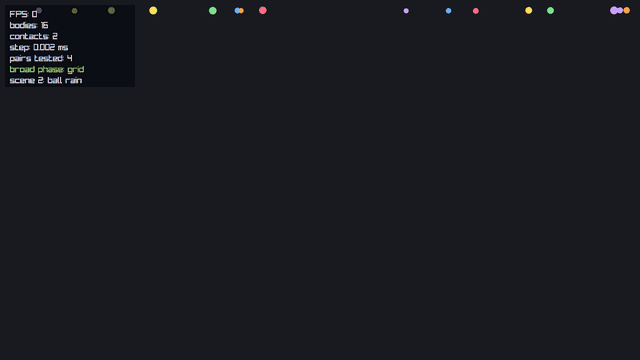
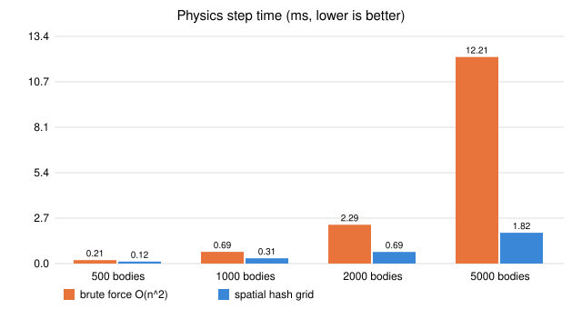

# Impulse



Impulse is a 2D rigid body physics engine I'm writing from scratch in C++20. Right now it handles circles: gravity, collisions with restitution, a fixed 120 Hz timestep, and a spatial hash broad phase that lets it run a few thousand bodies without breaking a sweat. raylib is only used to open a window and draw stuff, all the physics code is mine. Boxes with rotation and friction are next.

## Features

- Fixed timestep loop at 120 Hz, decoupled from rendering
- Semi-implicit Euler integration
- Circle vs circle collision detection
- Impulse based collision response with restitution, solved with sequential impulses (10 iterations)
- Positional correction with slop so piles don't sink into each other
- Uniform spatial hash grid broad phase, with a brute force mode to compare against
- Mouse: click to spawn a ball, drag to throw it
- Scenes: `2` ball rain (2,000 balls), `5` stress test
- Debug keys: `F1` contact points and normals, `F2` broad phase grid, `F3` grid vs brute force, `R` restart scene
- Headless benchmark that prints CSV
- Unit tests for the math, collision detection, momentum and energy conservation, and determinism, running in GitHub Actions

## How it works

Every physics step (1/120 s) goes through the same pipeline:

```
  bodies
    |
    v
  broad phase       spatial hash: which pairs are close enough to bother checking?
    |
    v
  narrow phase      exact shape test for each candidate pair -> contact manifolds
    |
    v
  integrate forces  v += (gravity + F/m) * dt
    |
    v
  solve contacts    sequential impulses, 10 passes over every contact
    |
    v
  integrate vel.    x += v * dt  (using the new v, that's the "semi-implicit" part)
    |
    v
  fix overlap       push bodies apart by whatever penetration is left past the slop
```

The solver is the interesting part. For each contact it looks at the relative velocity along the contact normal. If the bodies are moving toward each other it applies an impulse that cancels that velocity (plus some bounce based on restitution). The catch is that fixing one contact can mess up a neighboring one, like when a ball sits at the bottom of a pile with ten other balls pushing on it. So instead of solving everything at once, it just loops over all the contacts several times, and each pass the impulses get a little closer to agreeing with each other. That's what Erin Catto calls sequential impulses, and it's what Box2D does.

Positional correction is there because the velocity solver alone lets bodies slowly sink into each other (floating point error plus gravity adding a bit of speed every step). After integrating, each pair gets pushed apart by 40% of its penetration, ignoring the first 1 cm so resting contacts don't jitter.

The broad phase hashes each body's bounding box into grid cells about 2x the average body size, then only tests pairs that share a cell. Instead of a `std::unordered_map` it counting-sorts the (cell, body) entries into one flat array, which is a lot nicer for the cache. A pair that overlaps several cells only gets reported from the cell holding the corner of the overlap region, so I don't need a set to remove duplicates. Pairs get sorted at the end so grid mode and brute force mode feed the solver in the exact same order, and the simulation comes out bit-identical either way (there's a test for that).

Bodies live in one `std::vector<Body>` and everything else (pairs, manifolds) refers to them by index, so the data stays contiguous.

## Benchmarks

Measured with `./build/bench` in a Release build on an Apple M3. Each row is the average over 300 steps after letting the pile settle for 1 second.

| Bodies | Brute force step (ms) | Grid step (ms) | Speedup | Pairs tested (brute) | Pairs tested (grid) |
|-------:|------:|------:|------:|-----------:|-------:|
| 500    | 0.21  | 0.12  | 1.7x  | 124,750    | 3,173  |
| 1,000  | 0.69  | 0.31  | 2.2x  | 499,500    | 8,610  |
| 2,000  | 2.29  | 0.69  | 3.3x  | 1,999,000  | 20,883 |
| 5,000  | 12.21 | 1.82  | 6.7x  | 12,497,500 | 58,193 |



At small counts the solver is most of the cost so the grid doesn't help that much, but brute force grows with n² and falls apart past a couple thousand bodies.

With rendering on and physics at 120 Hz, the app holds 60 FPS up to about **6,200 bodies** (`./build/impulse --find-max` keeps adding balls until the frame time goes over 16.7 ms).

## Building

You need CMake 3.20+ and a C++20 compiler. raylib and Catch2 get downloaded by CMake, so there's nothing else to install (on Linux you'll need the usual X11/OpenGL dev packages for raylib).

```bash
cmake -S . -B build -DCMAKE_BUILD_TYPE=Release
cmake --build build -j
./build/impulse
```

Run the tests with `ctest --test-dir build` and the benchmark with `./build/bench`.

## What I'd do next

- Boxes with rotation, SAT collision detection, and friction (in progress)
- Continuous collision detection, since fast small objects can tunnel through thin ones right now
- Joints and constraints (hinges, springs, ropes)
- Going 3D: quaternions for orientation, a full inertia tensor, and GJK/EPA instead of SAT

## References

- Erin Catto's GDC talks, especially "Fast and Simple Physics using Sequential Impulses" (2006) and "Understanding Constraints" (2014)
- [Box2D Lite](https://github.com/erincatto/box2d-lite), which I read a lot while figuring out the solver
- Glenn Fiedler, [Fix Your Timestep!](https://gafferongames.com/post/fix_your_timestep/)
- Christer Ericson, *Real-Time Collision Detection*
- Randy Gaul's "How to Create a Custom 2D Physics Engine" series on Tuts+
